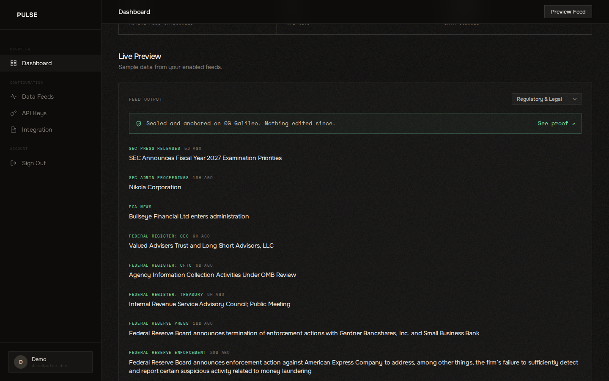
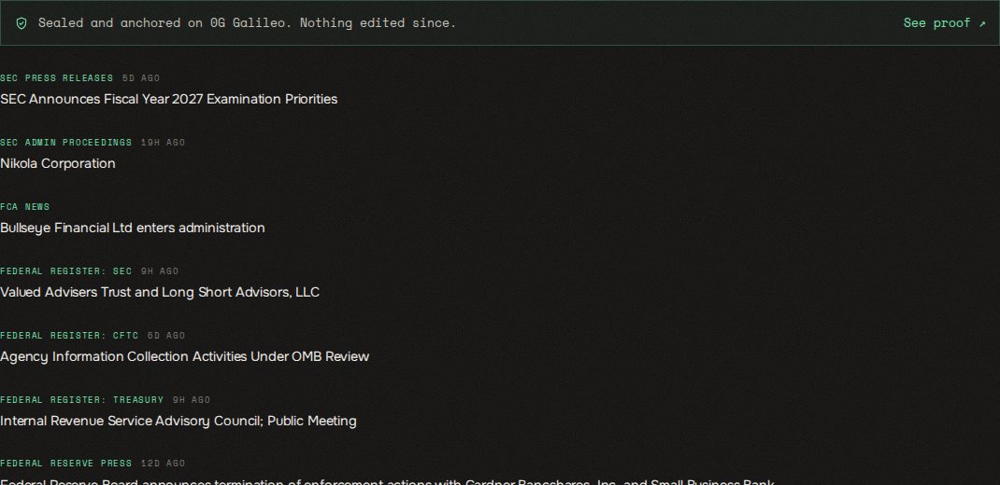
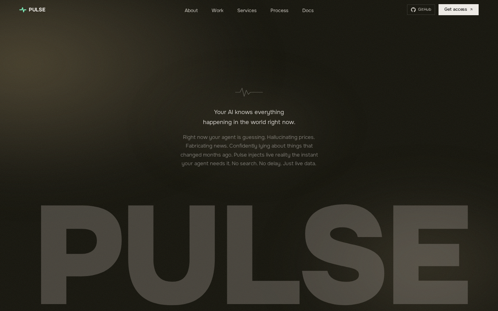
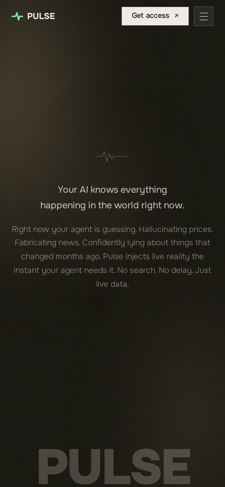
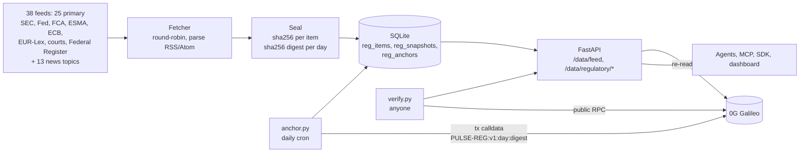

<div align="center">

# Pulse

**The live regulatory feed for AI agents, with proof.**
One API call returns what regulators and courts published today. Every item is sealed, and every day is anchored on-chain.

[**Live →**](https://getpulsedata.online) &nbsp;·&nbsp; [Dashboard](https://getpulsedata.online/dashboard?feed=regulatory) &nbsp;·&nbsp; [Try the feed](https://getpulsedata.online/data/feed/regulatory) &nbsp;·&nbsp; [Demo (3 min)](media/pulse_bli_demo.mp4)

</div>

---

## What Pulse is

AI agents now answer legal and compliance questions, but they answer from training data that is months old. Ask one what the SEC did this week and it guesses. In compliance, a guess is a liability, and a correct answer you cannot prove is barely better.

Pulse is a live data layer for agents: **1,221 verified sources across 23 categories**, served as structured JSON. Its **Regulatory & Legal** feed pulls from **38 verified sources**. **25 are primary sources** published by the regulator, court or legislature itself: the SEC, Federal Reserve, OCC, FTC, DOJ, FCA, ESMA, ECB, EDPB, the European Commission, EUR-Lex, UK legislation, US bills and public laws, the US Supreme Court and three federal appeals courts. **13 are tracked news topics** (MiCA, GDPR fines, the AI Act, OFAC sanctions, AML and more) for coverage the primary sources do not carry.

Three ideas shape it:

1. **Primary text first, clearly labelled.** Primary items come from the regulator's or court's own feed, or from the Federal Register. News coverage is tagged `GNews:` in the `feed` field, so an agent always knows which is which. Nothing is summarised or rewritten by a model.
2. **Sealed on arrival.** Each item is fingerprinted with sha256 the moment Pulse sees it, and each day's items roll up into one digest.
3. **Provable without trusting us.** Each day's digest is written into a public blockchain transaction. Anyone can re-download the items, recompute the hashes, and compare them to the chain. If a single word changed, the check fails and names the item.

---

## Product

### Regulatory & Legal feed

`GET /data/feed/regulatory` returns up to 80 recent items, interleaved across all 38 sources so courts and EU law are not crowded out by high-volume feeds. No API key needed.

```bash
curl https://getpulsedata.online/data/feed/regulatory
```

Each article carries its **feed**, **title**, **url** (the original document) and **published** time. The response also carries the day's **snapshot** (timestamp and digest).

### Sealed daily snapshots

| Endpoint | Returns |
|---|---|
| `GET /data/regulatory/snapshots` | Every sealed day, with its anchor transaction |
| `GET /data/regulatory/snapshot/{YYYY-MM-DD}` | All items for that day with their sha256, the digest, a fresh recomputation (`verified`, `broken_items`) and the on-chain anchor (`onchain.tx`, `onchain.explorer`, `onchain.verified`) |

Pulse re-reads the anchor transaction from the chain on every request, so even a full rewrite of the Pulse database shows up as `verified: false`.

### Verify it yourself

`verify.py` uses only the Python standard library and never takes Pulse's word for anything. It downloads the items, recomputes every hash, rebuilds the digest, and reads the transaction from the chain's public RPC.

```bash
python verify.py 2026-10-28
```

```
2026-10-28: 80 items
  item hashes recomputed   ok
  day digest rebuilt       ok  712e1c540b3321fd…
  on-chain anchor          ok  block 62574301
  written on chain:        PULSE-REG:v1:2026-10-28:712e1c540b3321fdbc9064377d53d00b6719542be0cf0c4951324da2eab308ba
VERIFIED
```

First anchor: [0x6791b847…f70d4](https://chainscan-galileo.0g.ai/tx/0x6791b847c3fb18e73de20c0352788810b8fb2a1c2e59e08e00d1bb267d2f70d4) on 0G Galileo testnet, from the Pulse anchor wallet `0xDF3c44548a767f2417A9DBa9C5Db6BcBE82Dbb4d`.

### Dashboard

The **Live Preview** on the dashboard has a picker for all 23 feeds. Picking **Regulatory & Legal** shows the headlines with their source and age, plus a seal line: **Sealed and anchored on 0G Galileo. Nothing edited since.** with a **See proof** link to the transaction.

### Everything else agents need

The same API serves 22 other live categories: crypto and on-chain data, markets, economics, news, politics, weather, climate, disasters, space, science, medical, tech, cybersecurity, sports, aviation, jobs and commodities. Pulse also ships an **MCP server** (`mcp_server.py`) with `pulse_regulatory` (search the feed) and `pulse_regulatory_verify` (prove a day against the chain) as built-in agent tools, and a small **Python SDK** in `sdk/python`. Full reference: [DOCS.md](./DOCS.md).

---

## Screenshots

| | |
|---|---|
|  |  |
| Regulatory feed, live data | The seal line with its proof link |





Captured from the live site by `tests/readme_shots.py`.

---

## Architecture



**How a seal is made.** Each item is reduced to `{feed, title, url, published}`, serialised as canonical JSON (sorted keys, no spaces) and hashed with sha256. The day's digest is the sha256 of all item hashes, sorted and concatenated. `anchor.py` sends one zero-value transaction from the anchor wallet to itself with calldata `PULSE-REG:v1:<day>:<digest>`. Regulatory items are never enriched or rewritten after sealing, so what the API serves is byte for byte what was sealed.

**Request path.** nginx serves the static site and proxies `/data/` and `/auth/` to the FastAPI service (`auth_service.py`, port 7072) and `/api/` to the Rust price engine (`src/`, port 7070, Axum + Redis).

| File | Job |
|---|---|
| `auth_service.py` | FastAPI service: accounts, API keys, all `/data/*` feeds, regulatory sealing and verification |
| `verified_feeds.py` | The verified source catalogue, including the 38 regulatory feeds |
| `anchor.py` | Writes a day's digest on-chain and records the transaction |
| `verify.py` | Independent verifier, standard library only |
| `src/` | Rust price aggregator (median consensus across sources, Redis cache) |
| `mcp_server.py` | MCP server exposing Pulse feeds as agent tools |
| `sdk/python/` | Python client |
| `site/` | Landing page, login and dashboard |
| `tests/readme_shots.py` | Captures the README screenshots from the live site |

---

## Run it yourself

**Requires** Python 3.11+, and optionally Rust and Redis for the price engine.

```bash
git clone https://github.com/itachi-exe/pulse && cd pulse
python -m venv .venv && . .venv/bin/activate
pip install fastapi uvicorn aiosqlite httpx "python-jose[cryptography]" bcrypt eth-account
echo "JWT_SECRET=$(python -c 'import secrets;print(secrets.token_hex(32))')" > .env
set -a; . ./.env; set +a; export DB_PATH=./pulse.db
uvicorn auth_service:app --port 7072 &             # API on 127.0.0.1:7072
curl localhost:7072/data/feed/regulatory           # seals today's snapshot

# optional: anchor on-chain (fund the wallet with testnet gas first)
echo "PULSE_ANCHOR_KEY=0x..." >> .env
python anchor.py
```

---

## Quality

| | |
|---|---|
| Sources | All 38 regulatory feeds were fetched and parsed with the same parser Pulse uses before going live. Dead or stale feeds were dropped. CFTC's own feeds block automated readers, so CFTC items come via the Federal Register. |
| Tamper test | On a copy of the database, editing one stored item gives `verified: false` and names that item. Editing an item and rewriting every hash and digest to cover it up still fails, because the chain disagrees. |
| Secrets | The session secret and the anchor key live in `.env`, which is gitignored and never committed. |

---

## Roadmap

- [x] Regulatory & Legal feed, 38 sources (25 primary, 13 news topics)
- [x] Per-item sha256 seals and daily digests
- [x] Daily on-chain anchor and an independent verifier
- [ ] Anchor on Base mainnet
- [ ] Chainlink CRE workflow so the feed is fetched and agreed on by a decentralised oracle network before anchoring
- [ ] Filters by regulator, jurisdiction and topic

---

<div align="center">
<sub>Live at getpulsedata.online. Anchored daily on 0G Galileo testnet. Built for BLI Legal Tech Hackathon 2.</sub>
</div>
