<div align="center">


# Pulse

**The live regulatory feed for AI agents, with proof.**

One API call returns what regulators and courts published today. Every item is sealed the moment it arrives, and every day is anchored on a public blockchain, so anyone can prove nothing was changed.

[**Live site →**](https://getpulsedata.online) &nbsp;·&nbsp; [Dashboard](https://getpulsedata.online/dashboard?feed=regulatory) &nbsp;·&nbsp; [Try the feed](https://getpulsedata.online/data/feed/regulatory) &nbsp;·&nbsp; [Demo video (3 min)](media/pulse_bli_demo.mp4)

<br>


</div>

---

## Contents

1. [The problem](#the-problem)
2. [What Pulse does](#what-pulse-does)
3. [A tour of every part](#a-tour-of-every-part)
   - [Landing page](#1-landing-page)
   - [Live demo on the landing page](#2-live-demo-on-the-landing-page)
   - [Feed catalogue](#3-feed-catalogue)
   - [How a request works](#4-how-a-request-works)
   - [Dashboard](#5-dashboard)
   - [Regulatory & Legal feed](#6-regulatory--legal-feed)
   - [The seal line](#7-the-seal-line)
   - [Choosing feeds](#8-choosing-feeds)
   - [Integration and API keys](#9-integration-and-api-keys)
   - [The API](#10-the-api)
   - [A sealed day](#11-a-sealed-day)
   - [The on-chain anchor](#12-the-on-chain-anchor)
   - [Verify it yourself](#13-verify-it-yourself)
   - [Try to fake it](#14-try-to-fake-it)
   - [Agent tools (MCP)](#15-agent-tools-mcp)
4. [How it is built](#how-it-is-built)
5. [Run it yourself](#run-it-yourself)
6. [Quality checks](#quality-checks)
7. [Roadmap](#roadmap)

---

## The problem

AI agents now answer legal and compliance questions. They answer from training data that is months old. Ask one what the SEC did this week and it guesses.

In compliance a guess is a liability, and a right answer you cannot prove is barely better. A compliance team needs to show *what the rule said, and when they saw it*.

## What Pulse does

Pulse is a live data layer for AI agents: **1,221 verified sources across 23 categories**, served as clean JSON from one API.

Its headline feed is **Regulatory & Legal**, with **38 sources**:

- **25 primary sources**, published by the regulator, court or legislature itself: the SEC, Federal Reserve, OCC, FTC, DOJ, FCA, ESMA, ECB, EDPB, the European Commission, EUR-Lex, UK legislation, US bills and public laws, the US Supreme Court and three federal appeals courts.
- **13 tracked news topics** (MiCA, GDPR fines, the AI Act, OFAC sanctions, AML and more), clearly labelled `GNews:` so an agent never confuses coverage with the rule itself.

Three ideas run through the whole product:

1. **Primary text first.** Items come straight from the source. Nothing is summarised or rewritten by a model.
2. **Sealed on arrival.** Every item gets a sha256 fingerprint the moment Pulse sees it. Each day's fingerprints roll up into one digest.
3. **Provable without trusting Pulse.** That digest is written into a public blockchain transaction every night. Anyone can re-download the day, recompute it and compare it to the chain. Change one word and the check fails, naming the item.

---

## A tour of every part

Every screenshot below is a 1440 px desktop capture. Site shots come from the live site, and terminal shots are the real output of the command shown. They are all produced by [`tests/readme_shots.py`](tests/readme_shots.py), so anyone can regenerate them.

### 1. Landing page

The front door at [getpulsedata.online](https://getpulsedata.online). It says in one line what Pulse is for: giving an agent what is true *right now* instead of what it remembers. **Get access** opens sign-in, and **GitHub** links here.


### 2. Live demo on the landing page

The second screen isn't a mock-up. As the page loads it calls the Pulse API and shows four real feeds (health, politics, breaking news, earthquakes), with how long the call took. A visitor sees what their agent would receive, at the moment they read it.

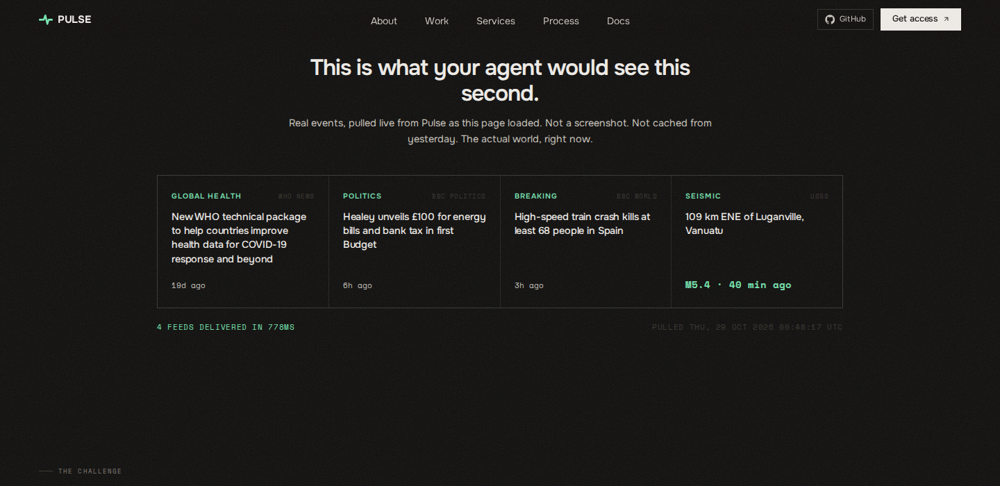

### 3. Feed catalogue

Three slides on what an agent gets: live world events (health, politics, breaking news, earthquakes), answers cross-checked across several independent sources, and a Python SDK that takes one call. Below them is the list of capabilities, including **Regulatory & Legal, Sealed**.

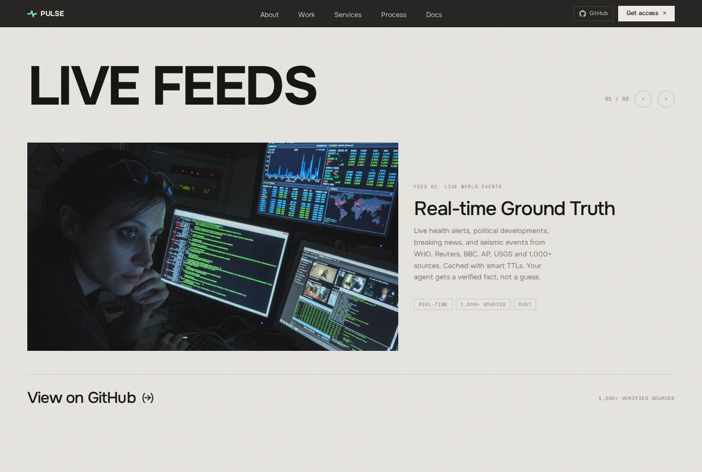

### 4. How a request works

The four steps behind every call: the agent asks, Pulse fetches live data, several sources are combined, and the answer goes back with its sources attached.

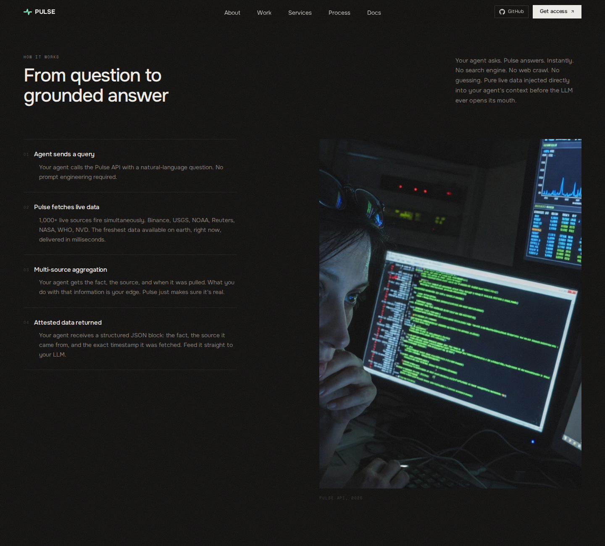

### 5. Dashboard

What a signed-in user sees. At the top: how many feed categories they have on, how many API keys they hold, and the total number of sources (1,221). Below that is **Live Preview**, a picker for all 23 feeds that shows real output from whichever one is chosen.

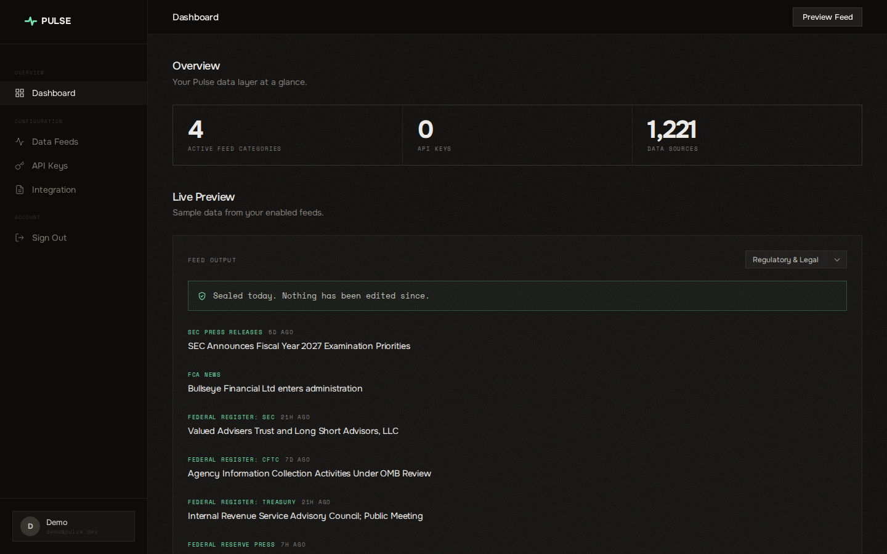

### 6. Regulatory & Legal feed

With **Regulatory & Legal** picked in Live Preview, the dashboard lists the latest items with the source in green (SEC Press Releases, FCA News, Federal Register: CFTC and so on), the headline and how old the item is. Each headline links to the original document on the regulator's own site.


### 7. The seal line

Above the regulatory items sits a single line telling the user whether today's set is sealed, whether it is anchored on-chain, and that nothing has been edited since. Its **See proof** link opens the blockchain transaction. This is the whole proof story in one glance, no reading required.


### 8. Choosing feeds

**Data Feeds** is where a user decides what their agent knows about. Each of the 23 categories is a card with its sources listed and an on/off switch. Changes apply at once: a disabled category returns `403` for that user's key, so an agent can never pull data its owner turned off.

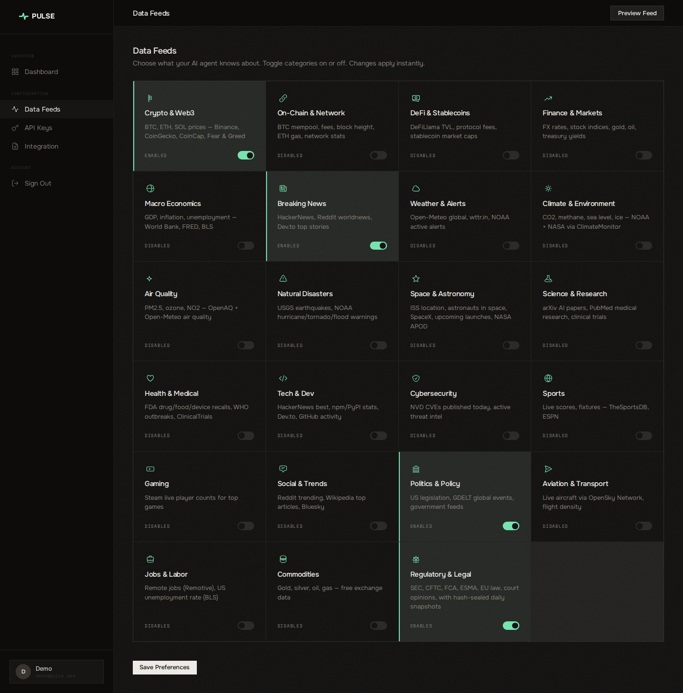

### 9. Integration and API keys

**Integration** has copy-paste snippets for Python, JavaScript, cURL and MCP, already pointed at the live API, plus the list of all 23 category names. Once a user makes a key under **API Keys**, the snippets fill it in automatically. Keys are stored only as hashes, and a key goes in the `X-Pulse-Key` header or `?key=`.

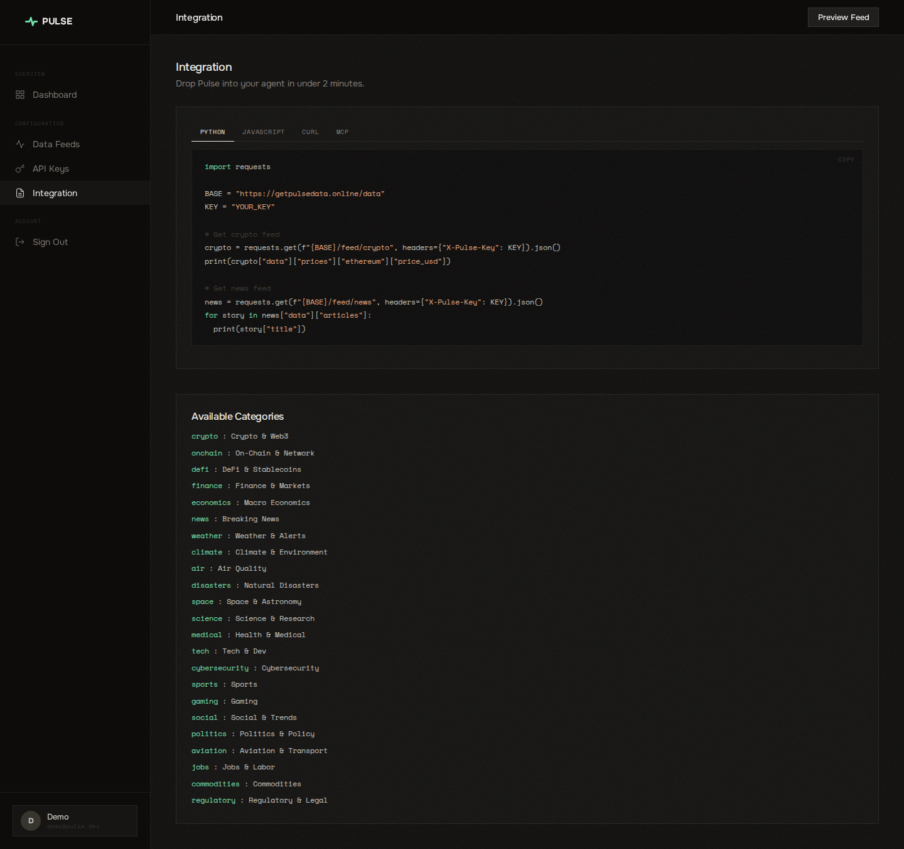

### 10. The API

`GET /data/feed/regulatory` needs no key. It returns up to 80 recent items, interleaved across all 38 sources so courts and EU law aren't crowded out by busy feeds. Each item has its **feed**, **title**, original **url**, **published** time and **sha256** seal. The response also carries today's **snapshot** time and digest.

```bash
curl https://getpulsedata.online/data/feed/regulatory
```

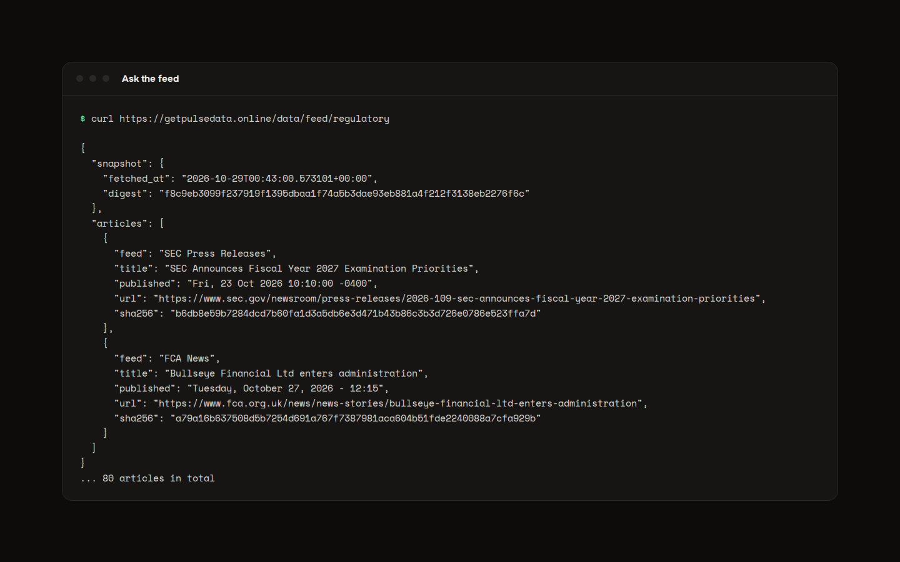

Other public endpoints:

| Endpoint | Returns |
|---|---|
| `GET /data/feed/{category}` | Any of the 23 categories. Eight preview categories are open, and the rest need a key |
| `GET /data/categories` | The list of categories and what each covers |
| `GET /data/regulatory/snapshots` | Every sealed day, with its anchor transaction |
| `GET /data/regulatory/snapshot/{YYYY-MM-DD}` | One sealed day in full (next section) |

Full reference: [DOCS.md](./DOCS.md).

### 11. A sealed day

`GET /data/regulatory/snapshot/{day}` returns everything Pulse sealed that day: each item with its hash, the day's digest, and the on-chain anchor. Pulse also recomputes the hashes and **re-reads the transaction from the chain on every request**. `verified` and `broken_items` are therefore live results, not stored flags, and even a full rewrite of the Pulse database shows up as `verified: false`.

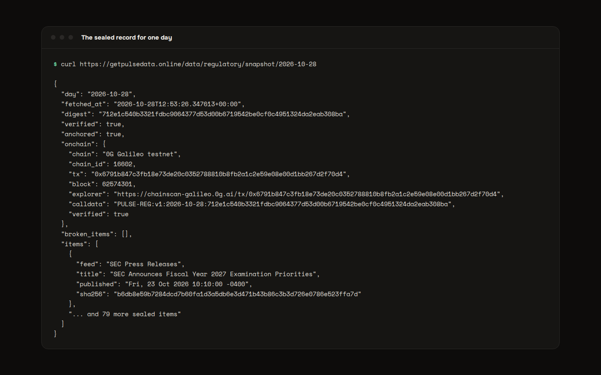

### 12. The on-chain anchor

Once a day (23:55 UTC) `anchor.py` sends one zero-value transaction from the Pulse anchor wallet to itself. Its only content is `PULSE-REG:v1:<day>:<digest>`. Here it is on the public 0G Galileo explorer, a site Pulse doesn't control. The highlighted box is the day's digest, written into the chain.

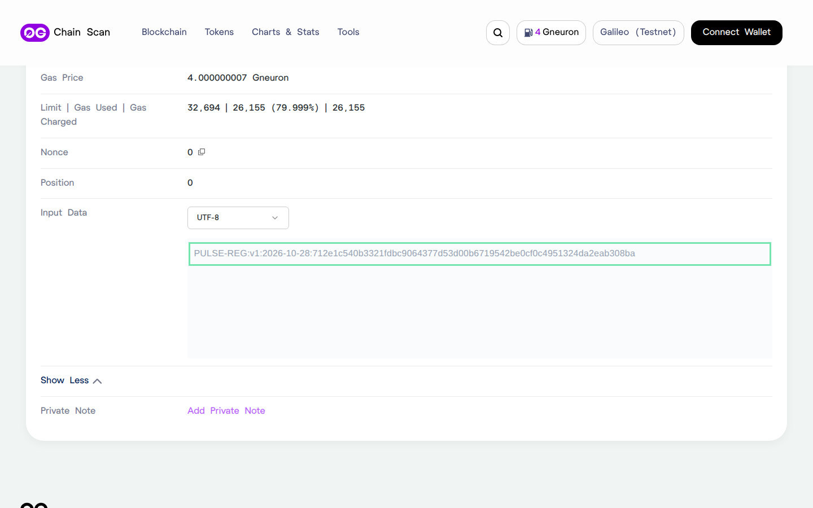

First anchor: [0x6791b847…f70d4](https://chainscan-galileo.0g.ai/tx/0x6791b847c3fb18e73de20c0352788810b8fb2a1c2e59e08e00d1bb267d2f70d4), wallet `0xDF3c44548a767f2417A9DBa9C5Db6BcBE82Dbb4d`.

### 13. Verify it yourself

[`verify.py`](verify.py) is a single file that uses only the Python standard library and never takes Pulse's word for anything. It downloads the day, recomputes every item hash, rebuilds the digest, then reads the transaction directly from the chain's public RPC and compares.

```bash
python3 verify.py 2026-10-28
```

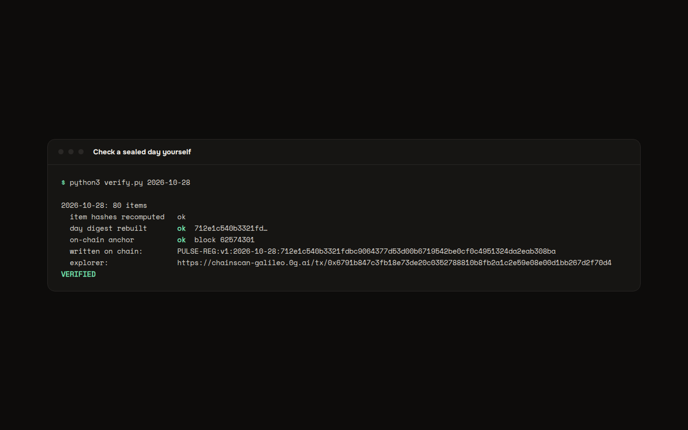

### 14. Try to fake it

[`tests/tamper_demo.py`](tests/tamper_demo.py) shows what happens if someone edits the record. It downloads a sealed day, quietly adds "(withdrawn)" to a real SEC headline in memory, and runs the same checks twice:

1. **A plain edit.** The item's hash no longer matches, and the check names the exact headline.
2. **A full cover-up.** The faker also rewrites that item's hash and the day's digest, so the local data looks perfectly clean. It still fails: the digest no longer matches the one already on the chain.

```bash
python3 tests/tamper_demo.py 2026-10-28
```

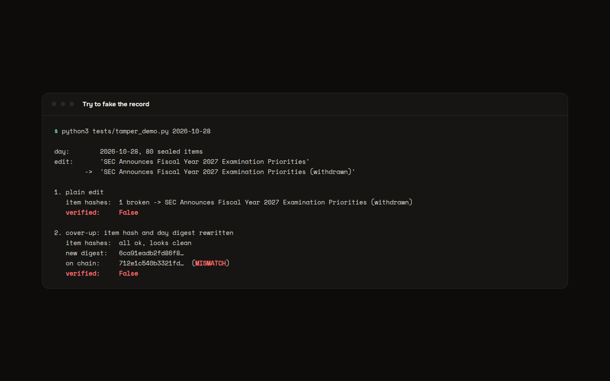

### 15. Agent tools (MCP)

[`mcp_server.py`](mcp_server.py) turns Pulse into tools an AI agent can call directly (Claude Desktop, Cursor or any MCP client):

| Tool | What the agent gets |
|---|---|
| `pulse_regulatory(query, limit)` | Search today's regulatory items, with source, date, link and seal |
| `pulse_regulatory_verify(day)` | Prove a sealed day against the chain |
| `pulse_feed(feed_type)`, `pulse_feeds()` | Any other category, and the list of them |
| `pulse_price`, `pulse_gas`, `pulse_health` | Prices, gas and service status |

Below, an agent asks for SEC items. The output is exactly what the tool returns (only the long source links are trimmed to fit the picture):

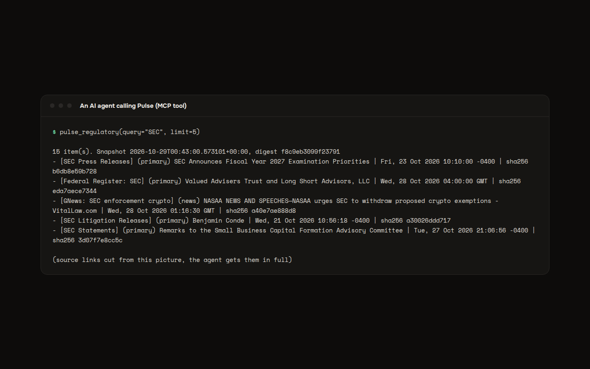

To add it to an MCP client:

```json
{
  "mcpServers": {
    "pulse": {
      "command": "/path/to/pulse/.venv/bin/python3",
      "args": ["/path/to/pulse/mcp_server.py"]
    }
  }
}
```

---

## How it is built

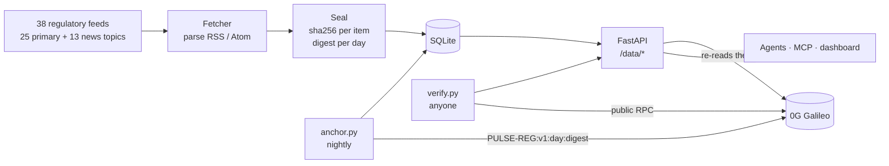

**How a seal is made.** Each item is reduced to `{feed, title, url, published}`, written as canonical JSON (sorted keys, no spaces) and hashed with sha256. The day's digest is the sha256 of all item hashes, sorted and joined. Regulatory items are never enriched or rewritten after sealing, so what the API serves is byte for byte what was sealed.

**Request path.** nginx serves the static site and passes `/data/` and `/auth/` to the FastAPI service (`auth_service.py`, port 7072), and `/api/` to the Rust aggregation engine (`src/`, port 7070, Axum and Redis).

| File | Job |
|---|---|
| `auth_service.py` | FastAPI service: accounts, API keys, all `/data/*` feeds, regulatory sealing and live verification |
| `verified_feeds.py` | The verified source catalogue, including the 38 regulatory feeds |
| `anchor.py` | Writes a day's digest on-chain and records the transaction |
| `verify.py` | Independent verifier, standard library only |
| `mcp_server.py` | MCP server exposing Pulse as agent tools |
| `src/` | Rust aggregation engine (median consensus across sources, Redis cache) |
| `sdk/python/` | Python client |
| `site/` | Landing page, sign-in and dashboard |
| `tests/readme_shots.py` | Regenerates every screenshot in this README |
| `tests/tamper_demo.py` | Shows an edit and a cover-up both being caught |
| `docs/brand/` | Logo files |

---

## Run it yourself

**Needs** Python 3.11+. Rust and Redis are optional (only for the `/api/` engine).

```bash
git clone https://github.com/itachi-exe/pulse && cd pulse
python -m venv .venv && . .venv/bin/activate
pip install fastapi uvicorn aiosqlite httpx "python-jose[cryptography]" bcrypt eth-account
echo "JWT_SECRET=$(python -c 'import secrets;print(secrets.token_hex(32))')" > .env
set -a; . ./.env; set +a; export DB_PATH=./pulse.db
uvicorn auth_service:app --port 7072 &
curl localhost:7072/data/feed/regulatory       # fetches and seals today's items

# optional: anchor on-chain (fund the wallet with testnet gas first)
echo "PULSE_ANCHOR_KEY=0x..." >> .env
python anchor.py
```

To check the live service without running anything, just use `python3 verify.py 2026-10-28`.

To regenerate the screenshots: `pip install playwright mcp && playwright install chromium && python tests/readme_shots.py`.

---

## Quality checks

| Check | Result |
|---|---|
| Sources | All 38 regulatory feeds were fetched and parsed with Pulse's own parser before going live. Dead or stale feeds were dropped. CFTC blocks automated readers, so CFTC items arrive through the Federal Register. |
| Independent proof | `verify.py` checks a day using only the public chain and the standard library. |
| Tamper test | `tests/tamper_demo.py`: a plain edit is caught and named, and a full cover-up is caught by the chain. |
| Honest labels | News coverage is always tagged `GNews:`, never presented as a primary source. |
| Secrets | The session secret and the anchor key live in `.env`, which is gitignored and never committed. |

---

## Roadmap

- [x] Regulatory & Legal feed, 38 sources (25 primary, 13 news topics)
- [x] Per-item sha256 seals and daily digests
- [x] Nightly on-chain anchor, independent verifier and tamper demo
- [x] MCP tools for search and verification
- [ ] Anchor on Base mainnet
- [x] [Chainlink CRE workflow](cre/pulse-regulatory-seal/daily-seal): the oracle network fetches the day's seal and must agree on its digest (simulated, deploy waiting on Chainlink access)
- [ ] Anchor the agreed seal on-chain from the CRE workflow
- [ ] Filters by regulator, jurisdiction and topic

---

<div align="center">
<sub>Live at getpulsedata.online · Anchored nightly on 0G Galileo testnet · Built for BLI Legal Tech Hackathon 2</sub>
</div>
